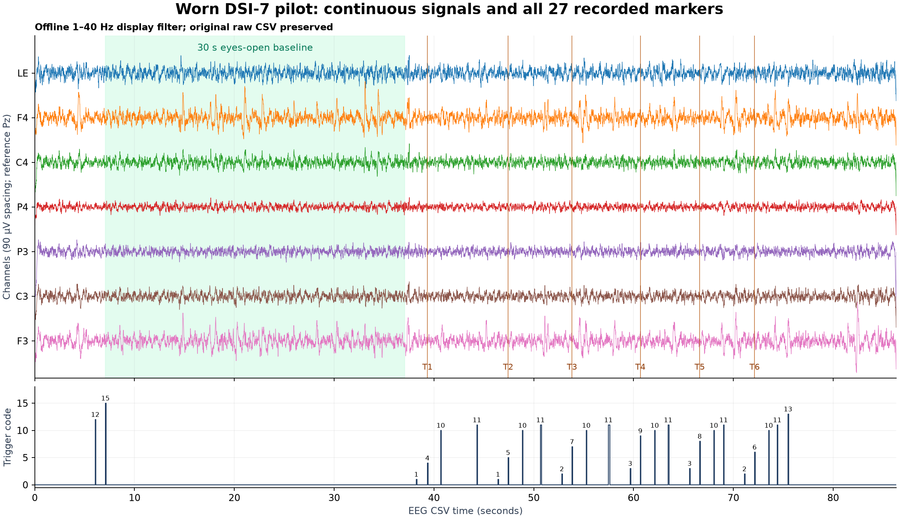
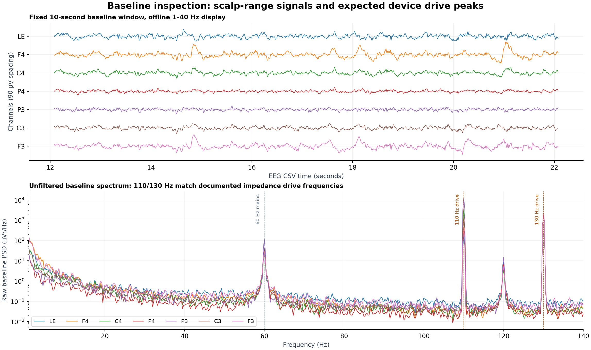

# Worn EEG pilot: verified recording and event delivery

**Result: your two-computer setup successfully recorded worn EEG channels and all 27 hardware event markers during the six-trial image-and-tone pilot.**

This is a useful equipment demonstration. The first run has a known audio/marker scheduling delay, so it should not be used for uncorrected sound-locked ERP analysis. Absolute sound pressure and physical sound onset have not been measured.

## What passed

| Check | Result |
|---|---|
| Headset / acquisition | DSI-7 SN:6717 / DSI-Streamer 1.08.147 |
| Recording | 25,896 samples at 300 Hz; 86.32 seconds |
| Export units / reference | Microvolts; Pz |
| Expected and recorded markers | 27 of 27; exact code order |
| Independent edge detection | Agrees exactly with the recording checker |
| Event column | Matches Trigger channel rising edges |
| Pulse widths | 50–150 ms; zero between every event |
| Timestamp / ADC sequence continuity | No detected gaps or counter discontinuities |
| ADC status | Zero for all 25,896 samples |
| Raw vs filtered exports | Time, Trigger, Event and acquisition counters agree exactly |
| Saturation screen | No active-channel samples at or above 9,800 µV in magnitude |
| Responses | Six ratings, covering all six category/level combinations |

Pulses were longer than the requested 50 ms on some trials because resets ran in the display loop. They remained separated and all arrived. Sequence/interval agreement between Mac and EEG clocks does not establish physical stimulus latency. Neither timestamp nor ADC checks rule out every possible acquisition problem.

## Worn signal review

The seven non-reference recorded channels are LE, F4, C4, P4, P3, C3 and F3. Pz is the recorded reference and is zero in the export; this is expected for a channel referenced to itself.

Baseline metrics use the fixed 8.08–36.08 second interval (28 seconds, 8,400 samples), inside the requested eyes-open baseline. For display only, the full raw recording was processed with a fourth-order Butterworth 1–40 Hz filter applied forward/backward. No filtering was written into the source CSVs.

| Channel | Baseline 1–40 Hz RMS (µV) | Raw full-record range (µV) |
|---|---:|---:|
| LE | 8.65 | 141.3 to 433.2 |
| F4 | 12.52 | -73.2 to 252.0 |
| C4 | 7.53 | -79.5 to 269.1 |
| P4 | 4.60 | -160.5 to 71.4 |
| P3 | 5.49 | -413.7 to -10.2 |
| C3 | 6.85 | -230.7 to 99.3 |
| F3 | 11.15 | 100.8 to 474.6 |

The traces are nonsaturated and have plausible scalp-signal variability. Frontal transients, including blink/eye-movement-like deflections, are visible; their source cannot be established from these channels alone. No impedance readings or independent physiological validation were supplied, so this review does not certify every epoch or channel as artifact-free.

The large 110/130 Hz raw spectral peaks are consistent with the continuous sensor/CMF impedance drive frequencies described in the [manufacturer manual, section 4.3](https://wearablesensing.com/wp-content/uploads/2022/09/DSI-7-User-Manual_v0.5.pdf). They should not be interpreted as brain activity at those frequencies. A 60 Hz peak is also visible. Time-domain processing should remove out-of-band drive components with an appropriate, documented filter; retain the raw recording.

## Trial-to-EEG alignment

| Trial | Category | Supplied file label | Image code | Tone code | Tone CSV time (s) | Rating (1–7) |
|---|---|---|---:|---:|---:|---:|
| 1 | pleasant | 70 | 1 | 4 | 39.3467 | 3 |
| 2 | pleasant | 90 | 1 | 5 | 47.4300 | 6 |
| 3 | neutral | 90 | 2 | 7 | 53.8300 | 7 |
| 4 | unpleasant | 90 | 3 | 9 | 60.6800 | 6 |
| 5 | unpleasant | 70 | 3 | 8 | 66.6267 | 2 |
| 6 | neutral | 70 | 2 | 6 | 72.1267 | 2 |

The lower-file trials received ratings 2–3 and higher-file trials 6–7. These are descriptive results from one person and one trial per cell; they do not establish an emotion effect or a calibrated loudness function. The 70/90 strings are file labels. Playback used gain 0.1, and acoustic dB SPL was not verified.

## Timing limitation and next run

The Mac command review found tone-marker request offsets from scheduled audio of approximately 100.2, 0.05, 0.08, −0.14, 16.6 and 9.0 ms. Those are software timings, not measured trigger-to-acoustic delays. Therefore do not treat this run as a validated sound-locked N1/P2 recording, and do not assume subtracting the software offset corrects physical onset.

The prepared pilot revision now silently warms both audio tracks and image drawing, schedules each tone about one second ahead, and records timing warnings over 20 ms. Re-run six trials in a fresh Windows recording to evaluate those changes. Then validate sound level and physical sound-onset timing with the final output chain before research ERP collection.

## Saved evidence

- `eeg_verification.json`: sample continuity, full pulse list and exact expected/recorded sequences.
- `signal_quality_review.json`: channel ranges, baseline metrics, spectral measurements, raw/filtered alignment, and source hashes.
- `trials_aligned_to_eeg.csv`: original image identities, tone files, ratings and EEG sample indices.
- `recorded_trigger_events.csv`: all 27 event onsets and widths.
- `mac_command_review.json`: Mac request timings; kept separate from received EEG markers.

All original raw/filtered CSV files were read only. SHA-256 hashes were compared before and after review. The acquisition-time `run.json` verification flag was left as recorded; this post-recording review and `eeg_verification.json` document the later successful file verification.
